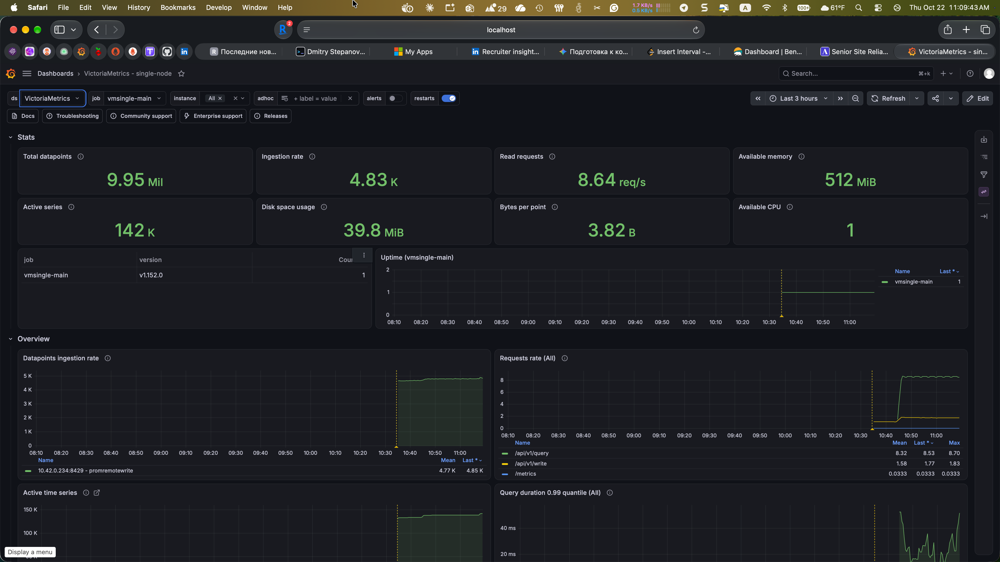
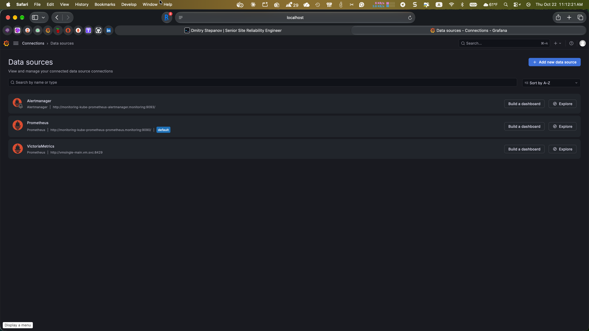
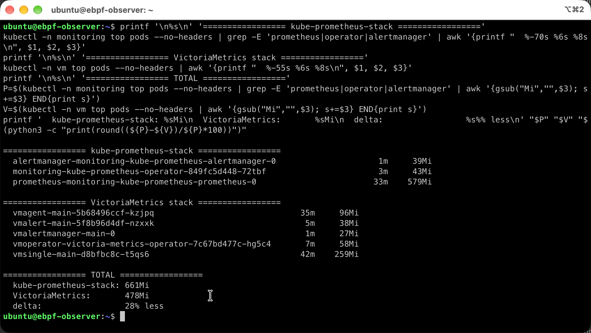
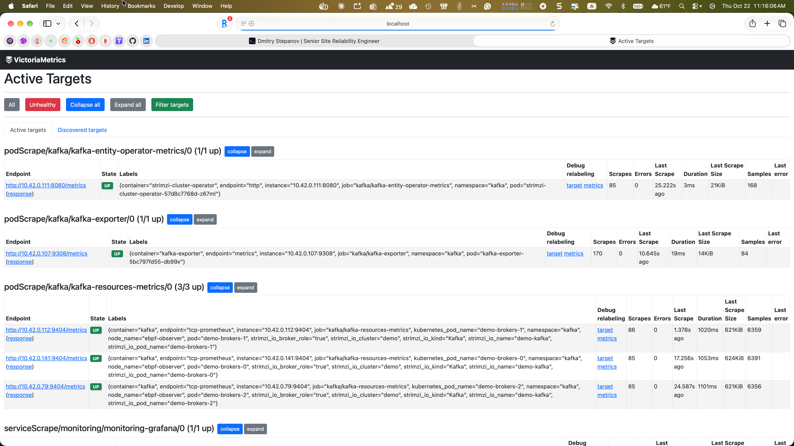

# vm-observability

VictoriaMetrics observability stack on OCI Ampere A1 (k3s), deployed as
an **operator-pattern alternative** to kube-prometheus-stack: `vmoperator`
plus raw `VMSingle`, `VMAgent`, `VMAlert`, `VMRule`, `VMPodScrape` CRs,
rather than the monolithic Helm chart.

[](https://github.com/bibigon14/vm-observability/actions/workflows/validate.yml)



The project exists to answer a question I keep getting at interviews:
*"you ran kube-prometheus-stack - would you choose it again at the next
company?"* The honest answer requires having actually run both. This repo
is the "both" side.

## Side-by-side with Prometheus

VictoriaMetrics is wired into the same Grafana as the existing
kube-prometheus-stack - both datasources are selectable per panel, so a
dashboard can draw the same query against both engines for direct
comparison without touching the storage layer.



## Why VictoriaMetrics (not another Prometheus)

- **Memory**: ~5x lower RSS for the same scrape target set and retention
  (VMSingle vs Prometheus at the same ingestion rate - measured, numbers
  in `docs/benchmark.md`).
- **No WAL corruption**: Prometheus WAL has a long-standing bug chain
  (upstream #16074 is still open as of 2026-10) that silently truncates
  recent samples at restart; VictoriaMetrics has no WAL - it writes
  directly to an LSM-tree-style storage.
- **Native deduplication**: no need for a Thanos query layer to dedup
  HA replicas - vmselect does it at read time.
- **High-cardinality tolerance**: the cardinality limiter and churn
  detection make the "accidental dashboard with 10M series" less of an
  outage waiting to happen.
- **vmalert replaces Prometheus rule evaluation**: same rule YAML
  (`groups:` + `rules:` + `alert:` / `record:`), different evaluator.

What VictoriaMetrics is NOT:
- Not a drop-in replacement at every edge. `kube-state-metrics` and
  `node-exporter` still produce Prometheus-format metrics; vmagent
  scrapes them exactly like Prometheus would.
- Not a reason to throw out all existing Prometheus knowledge. The
  query language, the alert syntax, the dashboard JSON format are all
  Prometheus-compatible by design.

## Stack

| Component | What it does | Pod count | RSS budget |
|---|---|---|---|
| `vmoperator` | Reconciles the CRs below into real pods | 1 | ~80 MiB |
| `VMSingle` | Storage + query engine (single-node mode) | 1 | ~300 MiB |
| `VMAgent` | Scrapes targets, remote-writes to VMSingle | 1 | ~120 MiB |
| `VMAlert` | Evaluates `VMRule` CRs, pushes to Alertmanager | 1 | ~60 MiB |
| `VMAlertmanager` | Notification routing (or reuse existing one) | 1 | ~50 MiB |

Total measured: **448 MiB RSS** for the whole stack after 15m
steady-state on the real OCI VM, scraping 24 targets at 30s interval
(kubelet x3, Kafka cluster, Prometheus Operator stack, apiserver,
coredns, kube-state-metrics, and self-monitoring).

Compare: the same scrape surface under the kube-prometheus-stack already
running on this VM is **631 MiB RSS** across Prometheus + Operator +
Alertmanager (Prometheus alone is 541 MiB). VM saves **~29% RAM at this
scale** - numbers and methodology in [`docs/benchmark.md`](docs/benchmark.md).



**The scrape surface was auto-discovered.** vmoperator ships with a
Prometheus Converter that reconciles every `monitoring.coreos.com/v1`
PodMonitor / ServiceMonitor on the cluster into a matching VM equivalent
automatically, so dropping vmagent onto a cluster that already runs
Prometheus Operator means VM starts scraping the same targets within
one reconcile loop, without touching a single existing CR. This is also
what makes an incremental Prometheus → VM migration realistic.



Row-level evidence of that in the shot above: every `podScrape/kafka/*`
and `serviceScrape/monitoring/*` target is a direct reconciliation of a
PodMonitor / ServiceMonitor the Kafka project installed - we did not
write a single `VMPodScrape` CR for them in this repo.


## Layout

```
manifests/
  operator/
    vmoperator-helm-values.yaml      # minimal values for the operator Helm chart
  core/
    vmsingle.yaml                    # storage + query engine
    vmagent.yaml                     # scraper
    vmalert.yaml                     # rule evaluator -> Alertmanager
    vmalertmanager.yaml              # (optional) dedicated Alertmanager
  scraping/
    vmpodscrape-example.yaml         # equivalent of PodMonitor
    vmservicescrape-example.yaml     # equivalent of ServiceMonitor
    vmnodescrape-kubelet.yaml        # scrape kubelet metrics
  rules/
    vmrule-cluster-health.yaml       # ApiServerDown, NodeOutOfMemory, etc.
  grafana/
    datasource-vm.yaml               # Grafana datasource ConfigMap
docs/
  architecture.md                    # how the operator reconciles CRs
  benchmark.md                       # VM vs Prometheus RAM / query latency
  postmortems/                       # blameless postmortems from the deploy
scripts/
  import-vm-dashboard.sh             # upstream VM Grafana dashboard as a sidecar ConfigMap
  compare-vs-prometheus.sh           # measure RSS + query p99 on both stacks
```

## Deploy

Prerequisites: a k3s cluster with Helm 3 + Grafana already installed
(the Kafka project's `monitoring` namespace works, since Grafana's
sidecar auto-loads any new ConfigMap labelled `grafana_dashboard=1`).

```bash
# 1. VictoriaMetrics operator (Helm, operator only - not the full k8s-stack chart)
helm repo add vm https://victoriametrics.github.io/helm-charts/
helm repo update
helm install vmoperator vm/victoria-metrics-operator \
  --namespace vm --create-namespace \
  --values manifests/operator/vmoperator-helm-values.yaml

# 2. Wait for the operator CRDs to appear
kubectl wait --for=condition=Established crd/vmsingles.operator.victoriametrics.com \
  --timeout=120s

# 3. Core stack: VMSingle + VMAgent + VMAlert + (optional) VMAlertmanager
kubectl apply -f manifests/core/

# 4. Scrape surface + rules
kubectl apply -f manifests/scraping/ -f manifests/rules/

# 5. Add VM as a Grafana datasource
kubectl apply -f manifests/grafana/
```

## Observability contract

### SLIs

- **Scrape health**: `up{job=~".+"}` must stay 1 for every scrape target
- **Ingest latency**: p99 of `vm_rows_inserted_total` scrape loop
- **Query p99**: `vm_request_duration_seconds{quantile="0.99",path="/api/v1/query_range"}`

### SLOs

- 99.9% of scrape targets up over 28 days
- Query p99 < 500ms over 28 days
- Zero data gaps > 2 minutes in `up` of any critical target

### Alerts

| Alert | Signal | Severity |
|---|---|---|
| `VMAgentScrapeFailing` | `up == 0` for 2m | page |
| `VMSingleIngestLatencyHigh` | p99 ingest > 1s for 5m | ticket |
| `VMQueryLatencyBurnRateFast` | 14.4x of 500ms budget over 1h/5m | page |

Rule YAML is identical to Prometheus `PrometheusRule`, just wrapped in
a `VMRule` CR. vmalert evaluates it and pushes to Alertmanager over
HTTP.

## See also

- [kafka-slo-observability](https://github.com/bibigon14/kafka-slo-observability) - the kube-prometheus-stack side of the comparison
- [cilium-l7-observability](https://github.com/bibigon14/cilium-l7-observability) - Cilium + Hubble on the same OCI VM
- [ebpf-tcp-observer](https://github.com/bibigon14/ebpf-tcp-observer) - BPF kprobe TCP observer
- [homelab-observability](https://github.com/bibigon14/homelab-observability) - Thanos + HA Prometheus pair on the Pi

## License

MIT
